# the_skool_yasmin_abdiyussuf - SQL-analys av MYH:s ansökningsresultat från 2025

Den här labben utfördes för att hjälpa den nya aktören The Skool att analysera data från resultat från MYH (Myndigheten för yrkeshögskolans) beslut för att kunna välja rätt utbildningar så att de kan öka deras chanser att bli beviljade. Jag analyserade MYHs resultat för ansökningsomgången 2025 (Tabell 3 som innehöll 1184 ansökningar) med hjälp av SQL i Oracle Database.

## Innehållet i repot

- data - Innehåller originaldata från MYH samt städad CSV
- 0_load_data.sql - Användes för att ladda in CSV i Oracle (Uppgift 0)
- 1_eda.sql - Grundläggande EDA (Uppgift 1)
- 3_egna_fragor.sql - Mina egna frågor (efter möte med stakeholdern (KG))
- images - Screenshots (uppgifterna 0,1 och 3)

  ## Uppgift 0: Förberedelser

Efter att ha skapat repot började jag med att skapa en .gitignore som är till för att ignorera vim-filer och .env. Det är viktigt att ignorera .env då det är där mitt lösenord ligger och detta ska inte hamna på GitHub då det är publikt och kan leda till att obehöriga får tillgång till mitt lösenord. Efter detta laddades data från MYH ner.

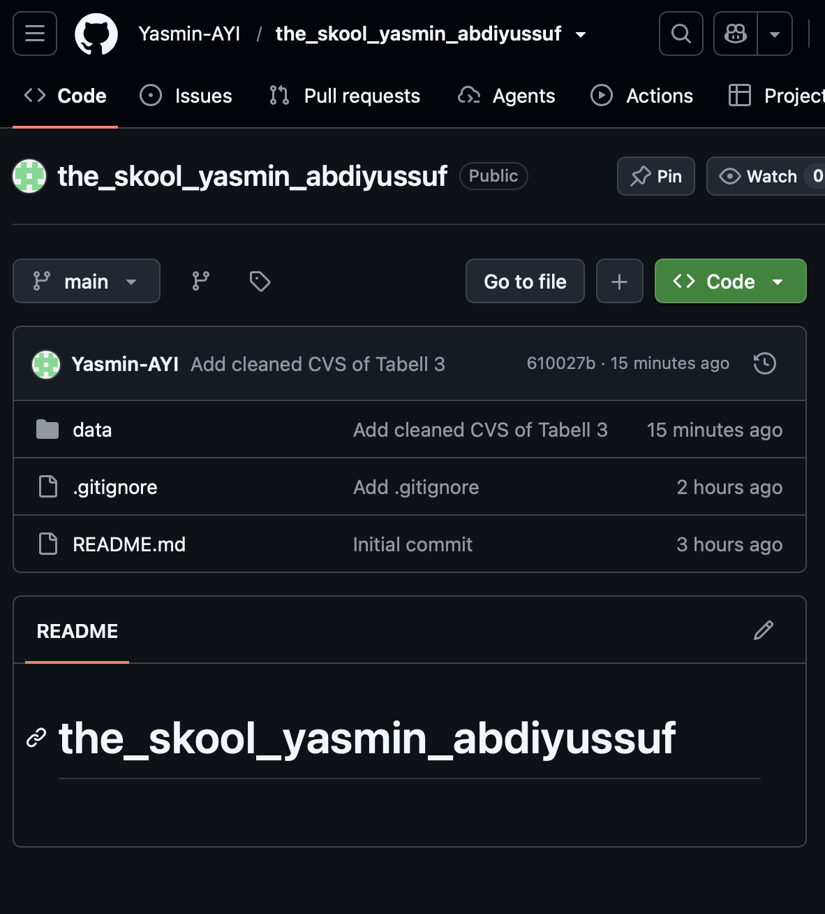

Från datan behöll jag bara Tabell 3 och sparade den som en CSV samt städade den. Detta för att LOAD i SQLcl ska kunna läsa filen.

- Först tog jag bort de 6 översta rubrikraderna
- Användes komma istället för semikolon
- Rensade bort 3 tomma kolumner
- Bytte namn på kolumnerna genom att ta bort mellanslag samt Å,Ä,Ö och %
- Fick hjälp av AI i detta steg

Genom att använda 0_load_data.sql skapade jag tabellen "ansokningar" och kontrollerade med COUNT (*) att alla rader kom med utan problem.Det var 1184 rader.

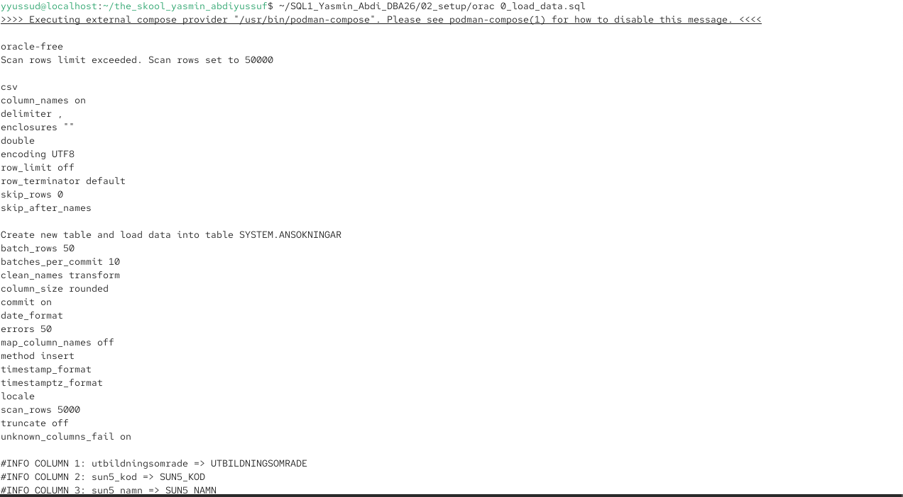
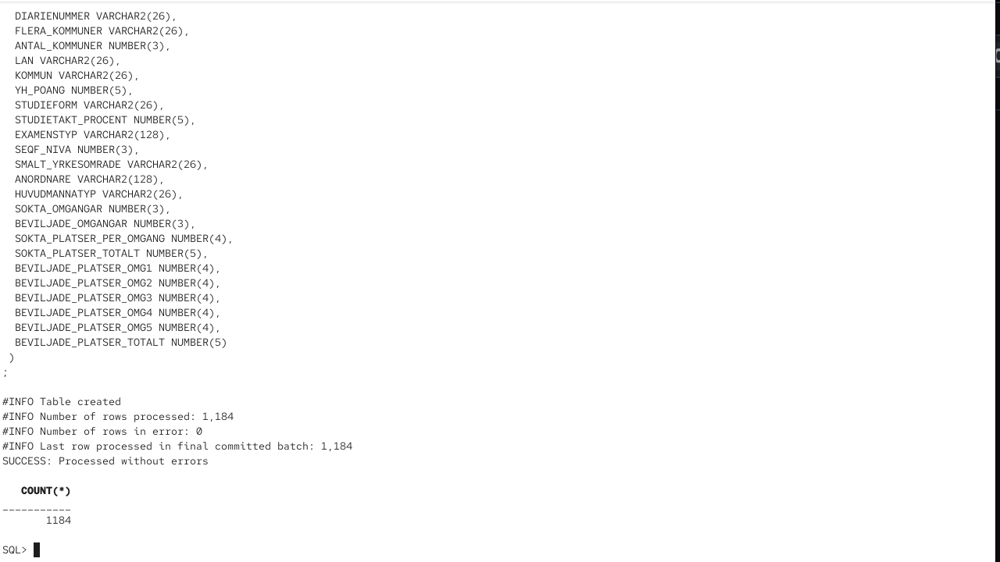

## Uppgift 1: Grundläggande EDA

EDA,Exploratory Data Analysis - Att utforska data för att kunna förstå den.

Alla frågor till uppgift 1 finns i 1_eda.sql. Högst upp började skriptet med SET PAGESIZE 200 och SET LINESIZE 200. Detta för att varje resultat skulle visas med en rubrik och på en rad. 

- a: Antal ansökningar per utbildningsområde - Ekonomi 239, Teknik 221 och Data/IT 220
- b: Antal beviljade per utbildningsområde - Teknik 117, Ekonomi 86 och Data/IT 31
- c: Antal avslagna per utbildningsområde - Data/IT 189
- d: Beviljade per utbildningsnamn inom Data/IT - 30 namn nästan alla med 1 var.
- e: Avslagna per utbildningsnamn inom Data/IT - 135 namn, fler med 4 avslag
- f: Beviljade per anordnare och utbildningsnamn inom Data/IT - Nackademin hade flest med 7 st
- g: Topp 5 län efter beviljade - Västra Götaland 89, Stockholm 89, Skåne 45
- h: Andel distans och bunden per område - Data/IT 75% bundet, Hälso- och sjukvård 72% distans
- i: Antal utbildningar med "AI" i namnet - 48 st
- 
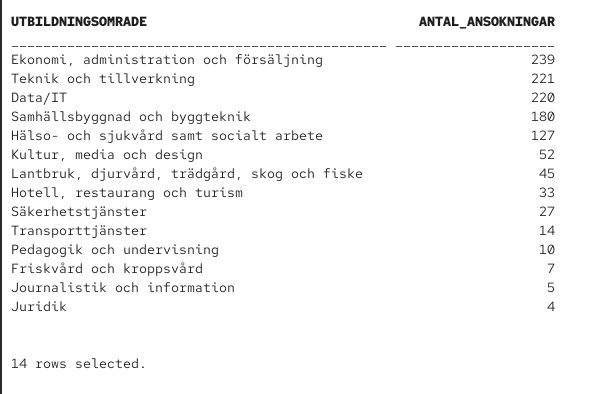
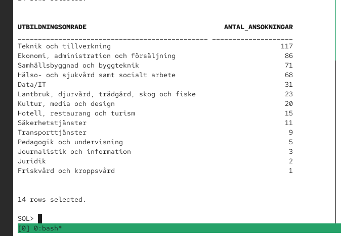
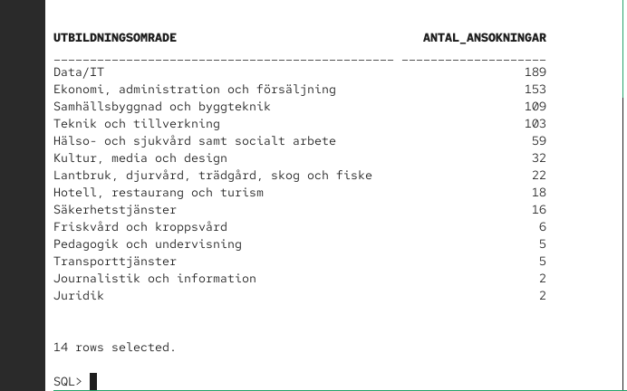
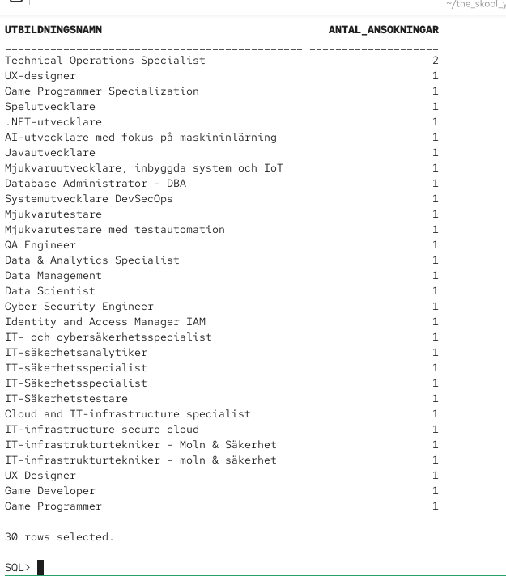
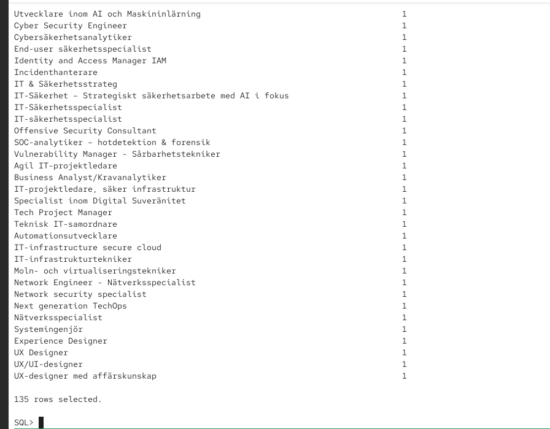
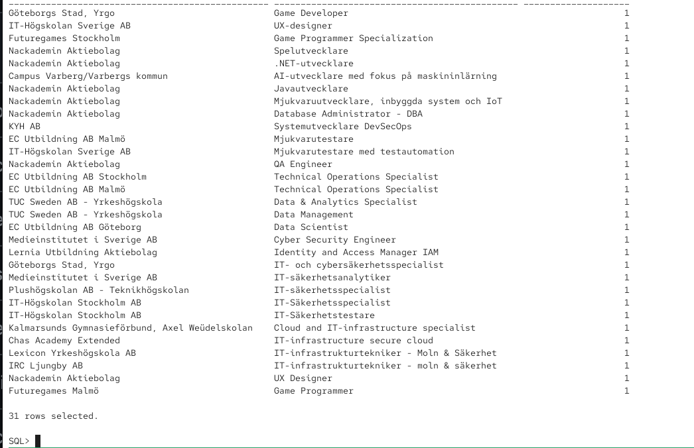
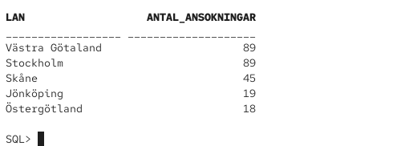
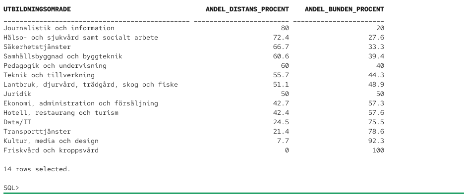
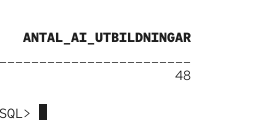

När jag jämförde frågorna a med b+c insåg jag att summan inte stämde. Det visade sig att det fanns ett tredje beslut utöver "Beviljad" och "Avslag" vilket var "Återkallad". 
I fråga g tog jag även bort värdet "Flera kommuner" eftersom det inte är ett län.

## Uppgift 2: Intervju med domänexpert

Stakeholder (KG) från The Skool deltog i ett zoom-möte med klassen. Där vi ställde frågor samt fick svar på vad de hade för behov.
Några punkter från mötet var:

- The Skool är en ny aktör utan beviljade utbildningar och vill börja med 2–3 utbildningar.
- Det är dyrt och tidskrävande att ansöka, så ansökningarna måste "pricka rätt".
- Data/IT har hård konkurrens: bara ca 14 % av ansökningarna beviljas.
- The Skool är flexibel både geografiskt och i val av distans eller platsbundet.
- Man vill förstå skillnader i beviljandegrad mellan områden, studieformer och privata/kommunala anordnare.
  Anteckningarna sammanställdes med hjälp av AI

  ## Uppgift 3: Datadrivna beslut

  Mina egna frågor som baserades på mötet med våran stakeholder (KG) finns i 3_egna_fragor.sql.

  1. Vilka områden har högst beviljandegrad? - Högst beviljandegrad hade Hälso- och sjukvård 53,5 %, sedan Teknik 52,9 %, och Data/IT 14,1 % hade lägst. Detta betyder att det är bättre för The Skool att satsa på områden med hög beviljandegrad och många ansökningar alltså är det bättre att undvika Data/IT.
  2. Beviljas distans eller platsbundet oftast? - Bunden 42,5 %, Distans 35 %. Platsbundna beviljades mer, The skool var även öppna till att hyra lokaler (från mötet).
  3. Privat eller kommunal anordnare? - Kommun 58,5 %, Region 50 %, Privat 35,3 %. Som en privat aktör behöver The Skool veta att de har tuffare odds och måste satsa på välgjorda ansökningar.

Viktigt för The Skool att tänka på är att inte satsa på områden som tex Juridik. Procentuellt ser det bra ut men det är viktigt att tänka på att det är få ansökningar vilket ger en opålitlig procent.

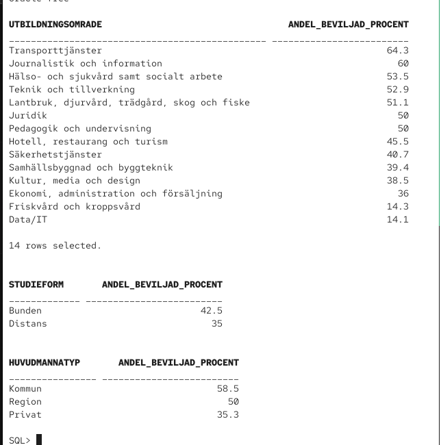

## Användning av AI

I denna Labb använde jag AI som en bollplanka för frågor samt felsökning.

- Jag skrev alla SQL frågor själv men fick hjälp av AI när jag stötte på problem. 
- AI hjälpte även med att förstå lärarens LOAD exempel
- AI hjälpte att städa upp CSV:n samt mina mötesanteckningarna.

